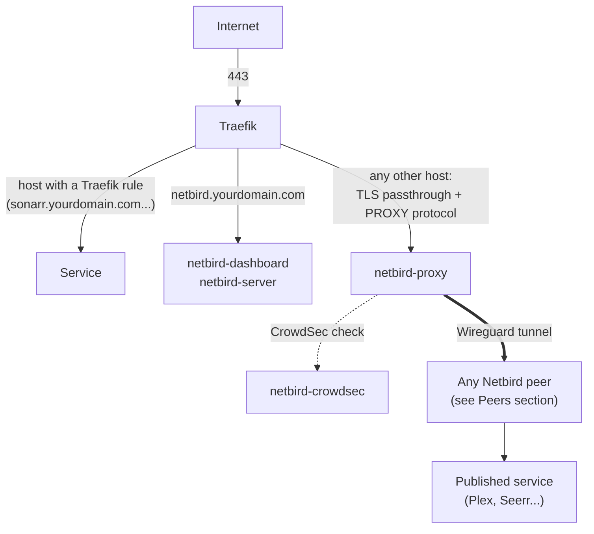
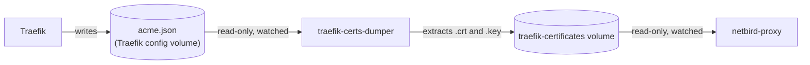

# Netbird

## Table of content

* [What is it for?](#what-is-it-for)
* [How it works in the seedbox](#how-it-works-in-the-seedbox)
* [Requirements](#requirements)
* [Installation](#installation)
* [Peers: how the proxy reaches your services](#peers-how-the-proxy-reaches-your-services)
* [Publish a service through Netbird](#publish-a-service-through-netbird)
  * [Make all your public services go through Netbird](#make-all-your-public-services-go-through-netbird)
* [CrowdSec](#crowdsec)
* [Certificates: traefik-certs-dumper](#certificates-traefik-certs-dumper)
* [Files](#files)
* [Troubleshooting](#troubleshooting)

## What is it for?

[Netbird](https://netbird.io/) is a self-hosted mesh VPN based on Wireguard. In the seedbox, it is used for two things:

* **A private network** between your devices (phone, laptop...) and your server: your devices reach your services as if they were at home, without exposing these services on the Internet.
* **A public reverse proxy with access control**, to publish only the services you choose (Plex and Seerr for example), protected by an authentication (SSO, password, PIN code), IP or country restrictions and [CrowdSec](#crowdsec). The request goes from the Netbird proxy to the service through the Wireguard network.

So Traefik and Netbird do not have the same role:

| | Traefik rule (``config.yaml``) | Netbird service (Netbird dashboard) |
|-|--------------------------------|-------------------------------------|
| Typical use | Services reachable from your LAN or your VPN (``internalOnly: true``) | Services published on the Internet |
| Authentication | http authentication (``httpAuth``) | SSO, password, PIN code, header, Netbird groups |
| Protection | Allowed IP ranges | IP and country rules, CrowdSec, access logs |

> Netbird is marked as **experimental** in the seedbox: its reverse proxy is a beta feature of Netbird, and its setup needs more steps than other services. Official documentation: [Reverse Proxy](https://docs.netbird.io/manage/reverse-proxy) and [Enable Reverse Proxy](https://docs.netbird.io/selfhosted/migration/enable-reverse-proxy).

## How it works in the seedbox

The ``netbird`` service starts six containers:

| Container | Role |
|-----------|------|
| ``netbird-server`` | Netbird server: management, signal, relay, STUN (UDP port 3478) and embedded identity provider |
| ``netbird-dashboard`` | Web interface, on ``netbird.yourdomain.com`` |
| ``netbird-docker-agent`` | Optional Netbird client running in Docker. It only sees the Docker network of the seedbox: see [Peers](#peers-how-the-proxy-reaches-your-services) |
| ``netbird-proxy`` | Netbird reverse proxy: terminates TLS for the services you publish and forwards requests through the Wireguard network |
| ``netbird-crowdsec`` | [CrowdSec](#crowdsec) engine, used by the proxy to block malicious IPs |
| ``traefik-certs-dumper`` | Gives the wildcard certificate of Traefik to the proxy (see [below](#certificates-traefik-certs-dumper)) |

Traefik stays the only entry point (ports 80 and 443). It decides where a request goes with the requested hostname:



1. **A host which has a Traefik rule** (generated from ``config.yaml`` or from ``services/traefik/custom/rules/``) is handled by Traefik, as usual.
2. **``netbird.yourdomain.com``** goes to the dashboard and to the Netbird server. These rules are in [services/netbird/rules.yaml](../../services/netbird/rules.yaml), applied when the service is enabled.
3. **Any other host** is sent to ``netbird-proxy`` without being decrypted (TCP router ``proxy-passthrough`` of the same file, with the lowest priority). Traefik gives the real IP of the visitor to the proxy with the PROXY protocol.
4. The proxy terminates TLS with the wildcard certificate, applies the access rules of the service (authentication, IP, country, CrowdSec), then reaches the target through the Wireguard tunnel, by one of your [Netbird peers](#peers-how-the-proxy-reaches-your-services).

The important consequence: **a host is handled either by Traefik or by Netbird, never both**. A service published by Netbird must use a host which has no Traefik rule.

## Requirements

* **A wildcard DNS record**: ``netbird.yourdomain.com`` and ``*.yourdomain.com`` must point to your server. If your DNS is Cloudflare, the hosts published by Netbird must be "DNS only": see below.
* **Ports**: 443/TCP (already needed by Traefik) and 3478/UDP (STUN) reachable from the Internet.
* **A wildcard certificate in Traefik**, so a [DNS challenge](../traefik.md#use-custom-acme-provider) (``TRAEFIK_CUSTOM_ACME_RESOLVER``): the proxy uses this certificate for every host it publishes.
* **A static IP for Traefik**: the proxy and the Netbird server only trust the IP of Traefik to know the real IP of visitors. Follow [Static IP for a service](../configuration.md#static-ip-for-a-service) entirely (``ip_range`` included), or the IP of Traefik may be taken by another container.
* **Your server must reach its own public IP** (hairpin NAT), or have a local DNS which resolves ``netbird.yourdomain.com`` to it. Otherwise published services answer ``504 Gateway Timeout``.

The static IP and the wildcard certificate are set in ``services/traefik/custom/compose.override.yaml``:

```yaml
services:
  traefik:
    networks:
      default:
        ipv4_address: 172.18.0.17
    # "command" is replaced as a whole by an override file, so the default one is repeated here
    command:
      - --certificatesresolvers.le.acme.email=${ACME_MAIL}
      # Ask for one certificate for the domain and all its subdomains
      - --entrypoints.secure.http.tls.domains[0].main=${TRAEFIK_DOMAIN}
      - --entrypoints.secure.http.tls.domains[0].sans=*.${TRAEFIK_DOMAIN}
```

## Installation

### 1. Enable the service and create its files

Enable ``netbird`` in ``config.yaml``, then create its configuration files:

```yaml
services:
  netbird:
```

```sh
tools/sync-templates.sh
```

Three files are created in ``services/netbird/custom/`` (see [Files](#files)).

### 2. Configure the Netbird server

Edit ``services/netbird/custom/config.yaml``:

| Key | Value |
|-----|-------|
| ``server.exposedAddress`` | ``https://netbird.yourdomain.com:443``, with your domain |
| ``server.auth.issuer`` | ``https://netbird.yourdomain.com/oauth2`` |
| ``server.auth.dashboardRedirectURIs`` | Replace ``yourdomain.com`` by your domain in both URLs |
| ``server.authSecret`` | A random secret: ``openssl rand -base64 32`` |
| ``server.store.encryptionKey`` | Another random secret: ``openssl rand -base64 32``. **Keep it**: it encrypts the database |
| ``server.reverseProxy.trustedHTTPProxies`` | The static IP of Traefik (``172.18.0.17/32``) |

### 3. First start

```sh
./run-seedbox.sh
```

Open ``https://netbird.yourdomain.com`` and create your administrator account (you can also define it before the first start, with ``server.auth.owner`` in ``config.yaml``). At this point, ``netbird-proxy`` cannot connect yet: it needs the keys created in the next step.

### 4. Create the keys

| Key | How to create it | Where to write it |
|-----|------------------|-------------------|
| Setup key, to connect your [peers](#peers-how-the-proxy-reaches-your-services) | Netbird dashboard > *Setup Keys* | Given to ``netbird up`` on each peer (or ``NB_SETUP_KEY`` in ``docker-agent.env`` for the optional Docker agent) |
| Token of the proxy (starts with ``nbx_``, shown only once) | ``docker exec -it netbird-server /go/bin/netbird-server --config /etc/netbird/config.yaml admin token create --name "seedbox-proxy"`` | ``NB_PROXY_TOKEN`` in ``proxy.env`` |
| CrowdSec key of the proxy | ``docker exec netbird-crowdsec cscli bouncers add netbird-proxy -o raw`` | ``NB_PROXY_CROWDSEC_API_KEY`` in ``proxy.env`` |

In ``proxy.env``, also check that ``NB_PROXY_TRUSTED_PROXIES`` is the static IP of Traefik.

### 5. Apply and check

```sh
./run-seedbox.sh
docker logs netbird-proxy
```

The proxy is ready when its logs contain:

```
loaded certificate: subject="*.yourdomain.com"
proxy peer authenticated successfully with management
Initial mapping sync complete
```

Then connect at least one [peer](#peers-how-the-proxy-reaches-your-services): the proxy needs one to reach your services.

## Peers: how the proxy reaches your services

The proxy does not reach your services directly: it goes through a **peer**, a machine connected to your Netbird network. What you can publish depends on what this peer can reach.

### Recommended: the Netbird client installed on your server

Install the Netbird client on the machine which runs the seedbox, as a regular application and not in Docker (see [Install NetBird](https://docs.netbird.io/get-started/install)), and connect it to your own server with a setup key:

```sh
netbird up --management-url https://netbird.yourdomain.com --setup-key <SETUP KEY>
```

This peer sees what your server sees:

* the server itself: services which use the network of the host (Plex), and ports published on the host
* the other machines of your LAN, if you use it as routing peer of a *Network* in Netbird. This is what lets you publish something which does not run on the seedbox (a NAS, a home automation box...)

### Redundancy: a second peer

You can install the Netbird client on another machine of your LAN which is always on (see [Install on Synology](https://docs.netbird.io/get-started/install/synology) for a NAS) and add it as a second routing peer of the same *Network*. Your LAN resources stay reachable when one of the two peers is down.

### The bundled Docker agent

The ``netbird-docker-agent`` container is a Netbird client running in Docker. It works without installing anything on the server, but **its routing stays inside the Docker network of the seedbox**: it cannot reach the other machines of your LAN. The setup described on this page does not use it, and publishing services through it has not been tested here.

If you do not use it, do not start it: add this to ``services/netbird/custom/compose.override.yaml``.

```yaml
services:
  netbird-docker-agent:
    profiles: ["disabled"]
```

## Publish a service through Netbird

Two things to do: free the host in Traefik, then create the service in the Netbird dashboard.

### 1. Choose a host which has no Traefik rule

As a host is handled either by Traefik or by Netbird, there are two possibilities in ``config.yaml``:

```yaml
services:
  # Plex has no Traefik rule (see its documentation): it is only published by Netbird, on plex.yourdomain.com
  plex:
  # Seerr keeps its Traefik rule for the LAN (seerr.yourdomain.com),
  # and is published by Netbird with another host (requests.yourdomain.com)
  seerr:
    rules:
      - internalOnly: true
```

Nothing else is needed on Traefik side: thanks to the wildcard DNS record and the passthrough router, ``plex.yourdomain.com`` and ``requests.yourdomain.com`` already reach the Netbird proxy.

> **Cloudflare**: the DNS record of a host published by Netbird must be "DNS only" (grey cloud), not proxied (orange cloud). The Netbird proxy must receive the TLS connection of the visitor as it is, and the proxy of Cloudflare ends it before: the service would answer a Cloudflare error (``520`` or another ``52x``). The real IP of visitors, needed by CrowdSec and by IP or country restrictions, would be lost too.

### 2. Create the service in the Netbird dashboard

In *Reverse Proxy* > *Services*, add a service:

* **Details**: mode *HTTP*, the subdomain (``plex``, ``requests``) and your domain.
* **Target**: where the proxy sends the requests. It is one of your [peers](#peers-how-the-proxy-reaches-your-services), or a resource reachable through them, with the port of the service.
* **Authentication**: SSO, password, PIN code... or none if the application has its own authentication.
* **Access Control**: IP and country restrictions, and CrowdSec mode (see [CrowdSec](#crowdsec)).

The kinds of targets and all options are described in [Netbird documentation](https://docs.netbird.io/manage/reverse-proxy).

> **Plex** runs on the network of the host (``network_mode: host``): its target is the peer of your server, port ``32400``. You also have to disable *Remote Access* in Plex settings: see [Plex documentation](plex.md#publish-plex-on-plexyourdomaincom-https-port-443).

### Make all your public services go through Netbird

To be sure that nothing is published by Traefik anymore, make all Traefik rules private with ``defaults``, and publish what you want from Netbird only:

```yaml
# Every Traefik rule is only reachable from your private networks...
defaults:
  internalOnly: true

services:
  sonarr:
  radarr:
  seerr:
  # ...and what is public is not handled by Traefik (Plex has no Traefik rule)
  plex:
```

"Private networks" are the IP ranges of the ``internal-only`` middleware, in your ``services/traefik/custom/middlewares.yaml``. Check that they match your LAN, and add the range of your Netbird network (``100.64.0.0/10`` by default) if your devices connected to the VPN must reach these services:

```yaml
    internal-only:
      ipAllowList:
        sourceRange:
          - "127.0.0.1/32"
          - "192.168.0.0/24"
          - "172.16.0.0/12"
          - "10.0.0.0/8"
          - "100.64.0.0/10"
```

## CrowdSec

[CrowdSec](https://www.crowdsec.net/) keeps a list of IPs to block ("decisions"). The Netbird proxy asks it for this list and refuses the matching visitors, before any authentication.

How it is wired in the seedbox:

* ``netbird-crowdsec`` runs the CrowdSec engine and its local API. It is not exposed outside of the Docker network.
* ``netbird-proxy`` is registered as a "bouncer" with the key created during the [installation](#4-create-the-keys) (``NB_PROXY_CROWDSEC_API_URL`` and ``NB_PROXY_CROWDSEC_API_KEY`` in ``proxy.env``).
* The real IP of visitors is required: this is why Traefik uses the PROXY protocol and why the proxy must trust the IP of Traefik (``NB_PROXY_PROXY_PROTOCOL`` and ``NB_PROXY_TRUSTED_PROXIES``).

CrowdSec is then enabled **for each service**, in the *Access Control* tab of the service in the Netbird dashboard:

| Mode | Effect |
|------|--------|
| ``observe`` | Only logs what would be blocked. Use it first to evaluate |
| ``enforce`` | Blocks listed IPs. If the proxy could not get the list yet, everything is blocked |

The proxy only connects to CrowdSec once a service uses it. Its logs then contain ``CrowdSec bouncer synced initial decisions``.

> The bundled CrowdSec container does not read any log of your services: decisions come from the community blocklist and from the ones you add yourself. On a new installation, the community blocklist can take up to two hours to arrive.

Useful commands:

```sh
# Is the proxy registered, and when did it last get the list?
docker exec netbird-crowdsec cscli bouncers list
# Current decisions
docker exec netbird-crowdsec cscli decisions list
# Block an IP for one hour, to test "enforce" mode
docker exec netbird-crowdsec cscli decisions add --ip 1.2.3.4 --duration 1h --reason "manual test"
# Remove it (do not use "--all": it would also empty the community blocklist)
docker exec netbird-crowdsec cscli decisions delete --ip 1.2.3.4
```

## Certificates: traefik-certs-dumper

The Netbird proxy terminates TLS itself, so it needs a certificate for every host it publishes. It could ask Let's Encrypt for them, but Traefik already owns a wildcard certificate (``*.yourdomain.com``) which covers all of them. ``traefik-certs-dumper`` shares it:



1. Traefik gets and renews the wildcard certificate, and stores it in ``acme.json`` like all its certificates.
2. ``traefik-certs-dumper`` watches this file. On each change, it extracts the certificates to the ``traefik-certificates`` volume (``$HOST_CONFIG_PATH/traefik-certificates``), one directory per domain: ``*.yourdomain.com/yourdomain.com.crt`` and ``.key``.
3. It then runs a hook which gives these files to the user of the proxy (``1000``) and gives read access to the ``PGID`` group, of which the proxy is a member. The group matters: some containers set the owner of your whole config directory to ``PUID:PGID`` each time they start (Jackett for example, which uses this directory as its own). Without it, the proxy could not read the private key anymore after such a start.
4. ``netbird-proxy`` reads the certificate in this volume (``NB_PROXY_CERTIFICATE_DIRECTORY``, ``NB_PROXY_CERTIFICATE_FILE`` and ``NB_PROXY_CERTIFICATE_KEY_FILE``, set in the docker-compose file) and reloads it when it changes. Its own Let's Encrypt support is disabled (``NB_PROXY_ACME_CERTIFICATES=false``).

So renewals need no action: Traefik renews, the dumper extracts, the proxy reloads.

## Files

| File | Content | Yours? |
|------|---------|--------|
| ``services/netbird/compose.yaml`` | The six containers | No. Use a [compose.override.yaml](../configuration.md#customize-a-bundled-service) |
| ``services/netbird/rules.yaml`` | Traefik rules: dashboard, server and passthrough to the proxy | No |
| ``services/netbird/custom/config.yaml`` | Configuration of the Netbird server | Yes, created from ``config.sample.yaml`` |
| ``services/netbird/custom/proxy.env`` | Token, trusted proxies and CrowdSec key of the proxy | Yes, created from ``proxy.sample.env`` |
| ``services/netbird/custom/docker-agent.env`` | Setup key of the optional Docker agent | Yes, created from ``docker-agent.sample.env`` |

Data is stored in ``$HOST_CONFIG_PATH``: ``netbird``, ``netbird-docker-agent``, ``traefik-certificates``, ``crowdsec-config`` and ``crowdsec-data``.

## Troubleshooting

| Symptom | Cause and solution |
|---------|--------------------|
| Traefik does not start: ``Address already in use`` | Another container took the static IP of Traefik. Reserve it with ``ip_range``: see [Static IP for a service](../configuration.md#static-ip-for-a-service) |
| ``reload certificate: ... permission denied`` in the logs of ``netbird-proxy`` | The proxy cannot read the private key written by ``traefik-certs-dumper``. Check the files: ``docker exec traefik-certs-dumper ls -lan /dump/*/``. The key must be readable by its group (``-rw-r-----``), and this group must be your ``PGID``. If not, restart the dumper to run its hook again: ``docker restart traefik-certs-dumper``. The proxy retries every 30 seconds, no need to restart it |
| No ``loaded certificate`` line in the logs of ``netbird-proxy`` | Traefik has no wildcard certificate: check the ``tls.domains`` arguments of Traefik and its DNS challenge |
| A published service answers ``504 Gateway Timeout``, the proxy logs ``failed connecting to Signal Service`` | Your server cannot reach its own public IP: enable hairpin NAT on your router, or use a local DNS |
| A published service answers a Cloudflare error page (``520`` or another ``52x``) | Its DNS record uses the proxy of Cloudflare (orange cloud): set it to "DNS only" (grey cloud). See [Choose a host which has no Traefik rule](#1-choose-a-host-which-has-no-traefik-rule) |
| A published service answers the 404 page of Traefik | Its host still has a Traefik rule: see [Choose a host which has no Traefik rule](#1-choose-a-host-which-has-no-traefik-rule) |
| Access logs and CrowdSec always see the IP of Traefik | ``NB_PROXY_TRUSTED_PROXIES`` does not contain the IP of Traefik, or ``NB_PROXY_PROXY_PROTOCOL`` is not ``true`` |
| ``netbird-proxy`` restarts in a loop | ``NB_PROXY_TOKEN`` is missing or revoked: create a new one (see [Create the keys](#4-create-the-keys)) |
